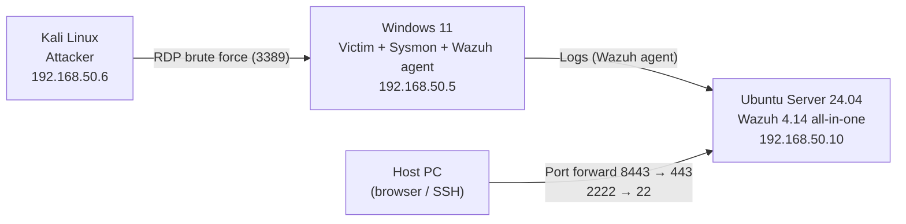
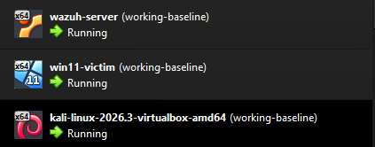
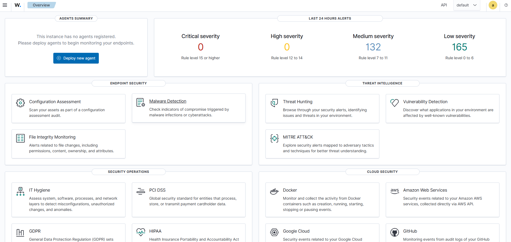
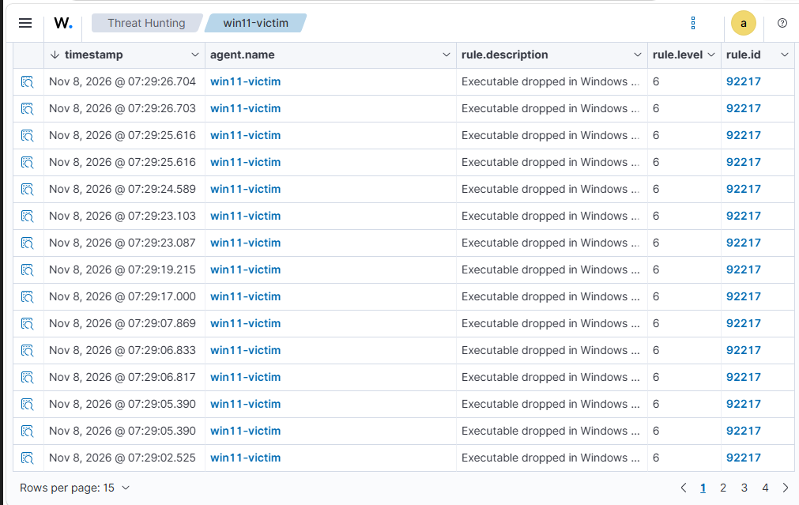
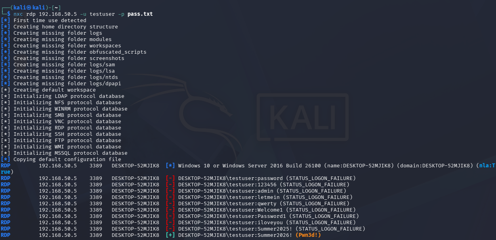
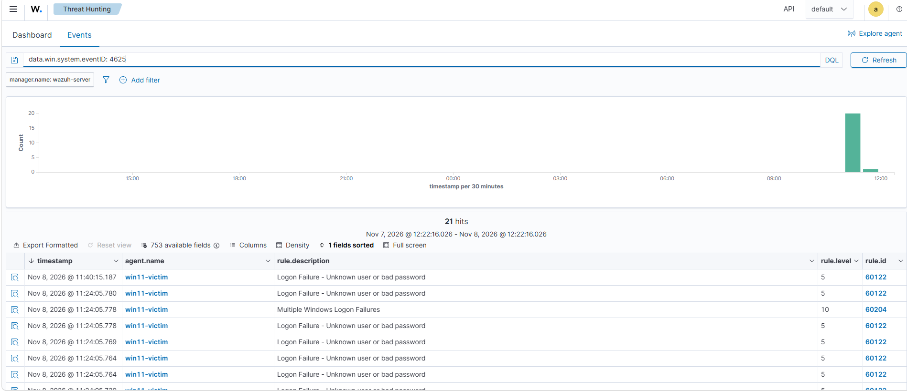
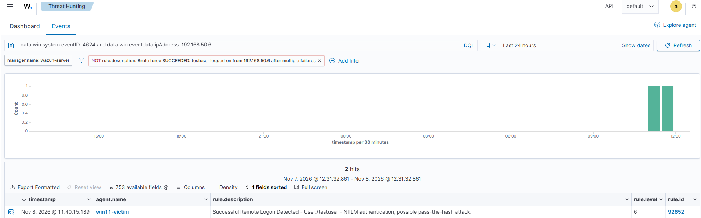
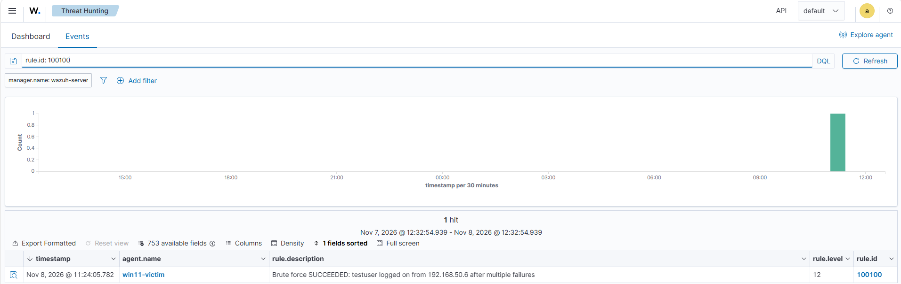

# Wazuh SIEM Home Lab: Detecting a Successful RDP Brute-Force Attack

A self-built SOC lab where I deployed the Wazuh SIEM, connected a Windows 11 endpoint with Sysmon, attacked it from Kali Linux, and wrote a custom correlation rule to catch something the default ruleset missed: **a brute-force attack that succeeds**.

**Skills shown:** SIEM deployment · log collection (Sysmon / Windows Event Logs) · attack simulation · alert triage · detection engineering · MITRE ATT&CK mapping · troubleshooting

---

## Lab Architecture



| Component | Details |
|---|---|
| Hypervisor | VirtualBox 7.2 on Windows (i7-13700F, 32 GB RAM, NVMe SSD) |
| Network | VirtualBox NAT Network `LabNet` (192.168.50.0/24), isolated from the home LAN |
| SIEM | Wazuh 4.14 all-in-one (indexer, server, dashboard) on Ubuntu Server 24.04.5 LTS, 8 GB RAM / 4 vCPU, static IP |
| Victim | Windows 11 Enterprise Evaluation, 6 GB RAM / 4 vCPU, Sysmon + Wazuh agent |
| Attacker | Kali Linux 2026.3 (prebuilt VirtualBox image), 4 GB RAM / 2 vCPU |



---

## Phase 1: Network Setup

Created a VirtualBox NAT Network (`LabNet`, 192.168.50.0/24, DHCP enabled) so the VMs can talk to each other and reach the internet for installs, while staying separate from my home network.

Port forwarding rules let me manage the server from my host:

| Name | Host | Guest | Purpose |
|---|---|---|---|
| wazuh-ssh | 127.0.0.1:2222 | 192.168.50.10:22 | SSH into the server |
| wazuh-dash | 127.0.0.1:8443 | 192.168.50.10:443 | Wazuh dashboard |

---

## Phase 2: Wazuh Server

- Installed Ubuntu Server 24.04.5 LTS with a static IP (192.168.50.10).
- Chose 24.04 over the newer 26.04 because Wazuh 4.x does not officially support 26.04 yet.
- Deployed Wazuh with the official installation assistant:

```bash
curl -sO https://packages.wazuh.com/4.14/wazuh-install.sh
sudo bash ./wazuh-install.sh -a
```



---

## Phase 3: Windows Endpoint + Sysmon

**Sysmon** was installed with the SwiftOnSecurity community config for detailed process, network, and file telemetry:

```powershell
Invoke-WebRequest https://download.sysinternals.com/files/Sysmon.zip -OutFile Sysmon.zip
Expand-Archive Sysmon.zip -DestinationPath .
Invoke-WebRequest https://raw.githubusercontent.com/SwiftOnSecurity/sysmon-config/master/sysmonconfig-export.xml -OutFile sysmonconfig.xml
.\Sysmon64.exe -accepteula -i sysmonconfig.xml
```

The **Wazuh agent** was enrolled from the dashboard. Then I added the Sysmon channel to the agent config (`C:\Program Files (x86)\ossec-agent\ossec.conf`), since it isn't collected by default:

```xml
<localfile>
  <location>Microsoft-Windows-Sysmon/Operational</location>
  <log_format>eventchannel</log_format>
</localfile>
```

**First triage:** the first alerts were 57 hits of rule 92217 *"Executable dropped in Windows root folder"* (level 6). I traced them to my own setup activity (Guest Additions, the agent installer, and Windows updates) and classified them as **benign / false positives**.



---

## Phase 4: Attack Simulation: RDP Brute Force

**MITRE ATT&CK:** T1110 – Brute Force

**Setup on the victim:** created a low-privilege `testuser` with a deliberately weak password, added it to *Remote Desktop Users*, and enabled RDP plus its firewall rule.

**Recon from Kali:**
```bash
nmap -Pn -p 3389 192.168.50.5
# 3389/tcp open  ms-wbt-server
```

**Attack** with NetExec and a 10-password wordlist (correct password last):
```bash
nxc rdp 192.168.50.5 -u testuser -p pass.txt
```
Result: 9 × `STATUS_LOGON_FAILURE`, then `[+] testuser:Summer2026! (Pwn3d!)`.



### What Wazuh detected (default rules)

| Time | Event | Rule | Level |
|---|---|---|---|
| 11:05:50.191 – .229 | 9 × failed logon (Event ID 4625) | 60122 – Logon Failure | 5 |
| 11:05:50.211 | Failure burst correlated | 60204 – Multiple Windows Logon Failures | 10 |
| **11:05:50.232** | **Successful logon (Event ID 4624) from 192.168.50.6** | **92652 – Successful Remote Logon (NTLM)** | **6** |




### The detection gap

1. **The most important event had the lowest priority.** The attacker getting in (level 6) was rated *below* the failed attempts (level 10), so a busy analyst could easily miss it.
2. **Nothing linked failures → success.** No default alert said *"the brute force worked."*
3. **The label didn't match the evidence.** Wazuh tagged the logon as *"possible pass-the-hash,"* but the evidence clearly shows a password brute force. The rule fires on any remote NTLM logon.

---

## Phase 5: Detection Engineering: Custom Correlation Rule

I wrote a rule that raises a **level 12** alert when a successful logon comes from the **same IP** that triggered the brute-force alert within the last 4 minutes.

`/var/ossec/etc/rules/local_rules.xml`:
```xml
<group name="local,windows,brute_force,">
  <rule id="100100" level="12" timeframe="240">
    <if_sid>60106, 92652</if_sid>
    <if_matched_sid>60204</if_matched_sid>
    <same_field>win.eventdata.ipAddress</same_field>
    <description>Brute force SUCCEEDED: $(win.eventdata.targetUserName) logged on from $(win.eventdata.ipAddress) after multiple failures</description>
    <mitre>
      <id>T1110</id>
    </mitre>
  </rule>
</group>
```

| Element | Purpose |
|---|---|
| `if_sid 60106, 92652` | Only evaluate successful Windows logons |
| `if_matched_sid 60204` + `timeframe 240` | Only if a brute-force alert fired in the last 4 minutes |
| `same_field win.eventdata.ipAddress` | Only if the success came from the same source IP |
| `mitre T1110` | Map the alert to ATT&CK |

### Result

Re-ran the attack, and the rule fired on the first attempt:

> **Level 12 – Brute force SUCCEEDED: testuser logged on from 192.168.50.6 after multiple failures**



### Validation (false-positive test)

Logged in once with the correct password at 11:40, outside the 4-minute window and with no failures before it. Wazuh recorded the logon (rule 92652, level 6) but rule 100100 did **not** fire, confirming the rule only triggers when a success follows a brute force.

A single correct login with no prior failures, run outside the 4-minute window, should **not** trigger rule 100100.

---


## Lessons Learned

- **Default rules aren't enough.** The SIEM saw every event, but only a custom correlation turned them into the alert that mattered.
- **Severity can mislead.** The compromise was rated lower than the noise around it, so triage has to follow the evidence, not just the level.
- **Validate alert labels.** "Possible pass-the-hash" was wrong for this attack. Understanding *why* a rule fired matters.
- **Your own activity creates alerts.** The first 57 alerts were from my own installs, which is a realistic example of false-positive triage.

## Next Steps

- [ ] Suspicious PowerShell execution detection
- [ ] New local admin account creation (Event ID 4720 / 4732)
- [ ] Credential dumping (LSASS access via Sysmon Event ID 10)
- [ ] Active response: automatically block the attacking IP

---

*Built by Ali Mohammed, CompTIA Security+ (2026)*
